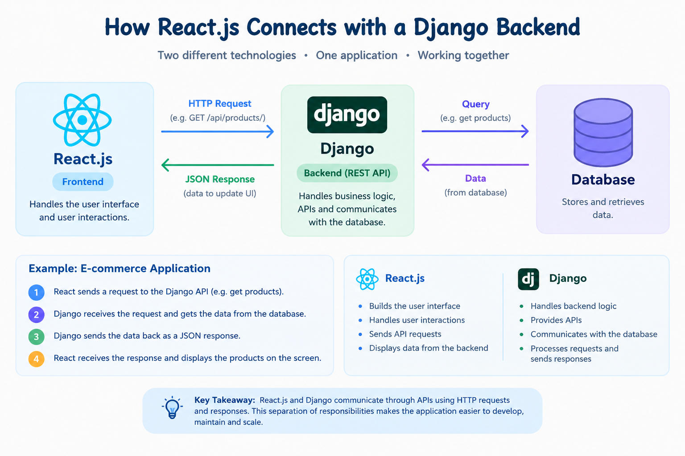

# How React.js Connects with a Django Backend

## Introduction

While working with web applications, I learned that React.js and Django can be used together for the frontend and backend.

React.js is used mainly for the frontend, where the user interacts with the application.

Django works on the backend. It handles the application logic, APIs, and database operations.

But how do React and Django communicate with each other?

They communicate through APIs.

---

## How React.js and Django Communicate

The basic flow is:

**React.js → HTTP Request → Django API → Database**

**React.js ← JSON Response ← Django API ← Database**

For example, when React needs some data, it sends a request to the Django backend.

Django receives the request, processes it, and gets the required data from the database.

Then Django sends the data back, usually as a JSON response.

React receives the response and displays the data on the screen.

---

## Simple Example

Let's take a simple e-commerce application.

Suppose a user opens the products page.

The flow can be:

1. React sends a request to the Django API.
2. Django receives the request.
3. Django gets the product details from the database.
4. Django sends the product data as a JSON response.
5. React receives the response.
6. React displays the products.

```text
React.js
   ↓
GET /api/products/
   ↓
Django API
   ↓
Database
   ↓
Product Data
   ↓
JSON Response
   ↓
React.js
   ↓
Products displayed
```

---



## What Does Each Part Do?

### React.js

* Creates the user interface
* Handles user interactions
* Sends API requests
* Displays the data received from the backend

### Django

* Handles backend logic
* Provides APIs
* Works with the database
* Processes requests
* Sends responses to the frontend

So, both have different responsibilities but work together through APIs.

---

## What I Learned

Before working with frontend and backend projects, I was not fully clear about how React and Django communicate.

After working with APIs, I understood that React does not directly access the Django database.

React sends a request to the backend API, Django processes it, and the required data is returned to React.

This helped me understand the connection between frontend, backend, APIs, and databases more clearly.

---

## Key Takeaway

The basic flow I learned is:

**React.js → API Request → Django → Database**

and then:

**Database → Django → JSON Response → React.js**

Understanding this flow makes it easier to understand how a real web application works from the frontend to the backend.
